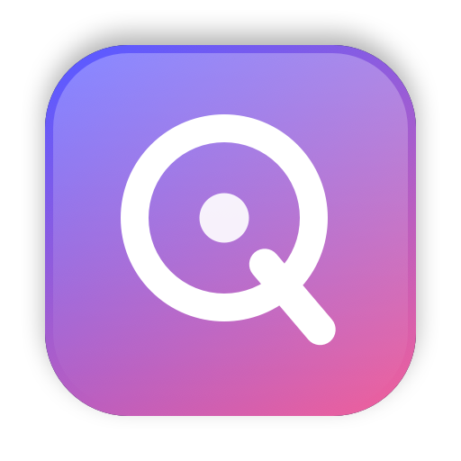
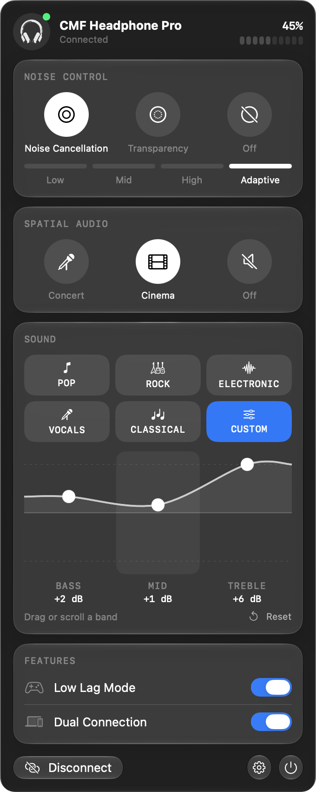
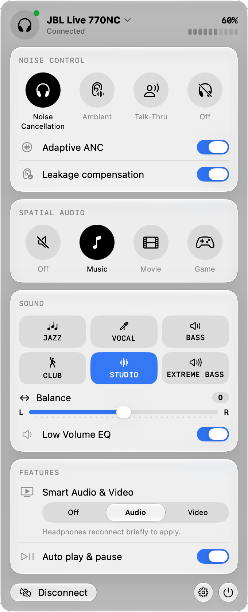
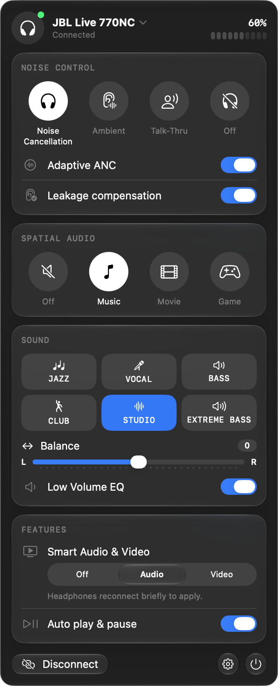
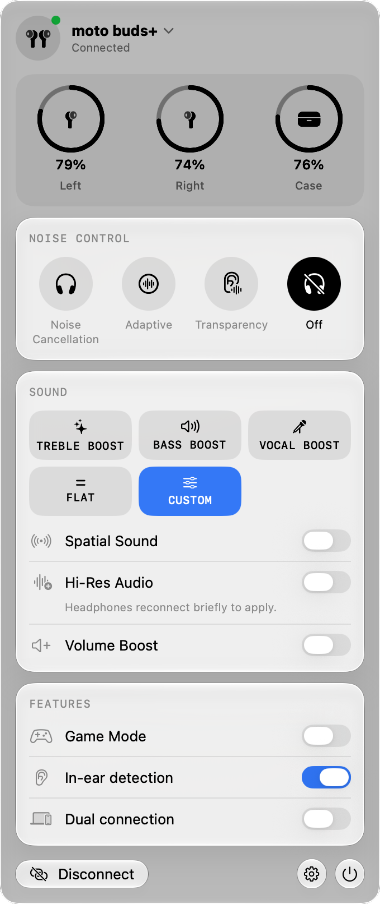
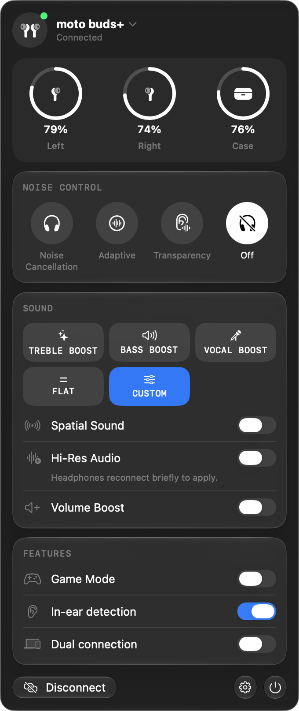
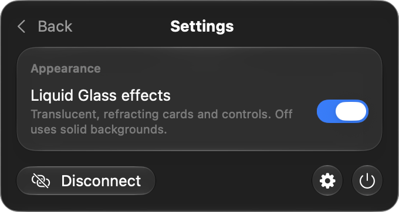

<p align="center">
  
</p>

<h1 align="center">Quietbar</h1>

<p align="center">A macOS menu bar app for controlling your headphones without reaching for your phone.</p>

<p align="center">
  <a href="https://github.com/StudioKeys/Quietbar/releases/latest"></a>
  <a href="https://github.com/StudioKeys/Quietbar/releases"></a>
  <a href="https://github.com/StudioKeys/Quietbar/stargazers"></a>
</p>

<p align="center">
  <a href="https://github.com/StudioKeys/Quietbar/releases/latest"></a>
</p>

Quietbar talks to the headphones directly over Bluetooth, the same way the manufacturer's phone app does, and
puts the everyday controls one click away in the menu bar.

## Supported headphones

| Headphones | Status |
|---|---|
| CMF Headphone Pro | Supported |
| JBL Live 770NC | Supported |
| moto buds+ | Supported |

Quietbar is an independent project. It is not affiliated with, endorsed by, or sponsored by JBL, Harman
International, Samsung Electronics, Motorola, Motorola Mobility, Lenovo, Apple or any other headphone or device
maker. All product names, trademarks and registered trademarks belong to their respective owners and are used only
to describe compatibility.

## Features

Pick your headphones from the switcher in the menu header. Quietbar remembers each pair after the first
connection and shows the name you gave it in Bluetooth settings.

### CMF Headphone Pro

<p align="center">
  
</p>

- Noise control: Noise Cancellation (Low, Mid, High, Adaptive), Transparency, Off
- Spatial Audio: Concert, Cinema, Off
- EQ presets: Pop, Rock, Electronic, Vocals, Classical and Custom
- Custom EQ: drag Bass, Mid and Treble on the response curve, ±6 dB
- Low Lag Mode and Dual Connection (the headphones reconnect briefly to apply Dual Connection)
- Battery level, status read-back and automatic reconnection

Every control is read back from the headphones after it changes.

The CMF control channel is implemented through the same public Bluetooth interoperability boundary used by the
Nothing X companion app. Quietbar does not send firmware-update or factory-reset commands. Standby mode, gesture remapping,
dual-connection device management, Find my headphones and codec switching are not enabled until their exact
read-back and rollback behavior is verified.

### JBL Live 770NC

<p align="center">
  
  
</p>

- Noise control: Noise Cancellation, Ambient Aware, Talk-Thru, Off
  - Adaptive ANC and leakage compensation while noise cancellation is on
  - Ambient level while Ambient Aware is on
- EQ presets: Jazz, Vocal, Bass, Club, Studio, Extreme Bass
- Spatial Sound with Music, Movie and Game modes
- Low Volume EQ
- Left/right balance
- Smart Audio & Video (Audio Mode / Video Mode) — the headphones reconnect briefly to apply it
- Auto play & pause
- Battery level, a menu bar icon that follows the noise mode, and automatic reconnection
- Battery-friendly reconnects: after five failed attempts Quietbar waits, and tries again when the headphones
  connect to the Mac, when you click **Connect** or when Bluetooth turns back on
- Liquid Glass styling that can be turned off in Settings

### moto buds+

<p align="center">
  
  
</p>

- Noise control: Noise Cancellation, Adaptive, Transparency, Off
- EQ presets: Treble Boost, Bass Boost, Vocal Boost, Flat, Custom
- Spatial Sound, Hi-Res Audio (the buds reconnect briefly to apply it), Volume Boost
- Game Mode, In-ear detection, Dual connection
- Left, right and case battery rings in the menu, and "L 65 R 61" in the menu bar (the buds report the case only
  while the buds are in it)

<p align="center">
  
</p>

## Requirements

- macOS 26 or later on an Apple silicon Mac
- Headphones paired with the Mac

## Install

1. Download `Quietbar.zip` from the [latest release](https://github.com/StudioKeys/Quietbar/releases/latest)
   and unzip it.
2. Move `Quietbar.app` to `/Applications`.
3. Open the app. The release is not notarized, so macOS blocks it the first time: open **System Settings** →
   **Privacy & Security**, scroll down and click **Open Anyway** next to the Quietbar message.
4. Allow Bluetooth access when macOS asks.

Only one app can control the headphones at a time. Close the manufacturer's phone app, or choose **Disconnect** in
Quietbar to hand control back to the phone. Quietbar remembers that choice until you click **Connect**.

## Build from source

Requires Xcode 26 (Swift 6.2).

```sh
Scripts/bundle.sh            # builds .build/Quietbar.app (ad-hoc signed)
open .build/Quietbar.app

open Quietbar.xcodeproj       # generated from project.yml; all targets and tests included
```

Set `QUIETBAR_SIGN_IDENTITY` to a code-signing identity to keep the Bluetooth permission across rebuilds.

```sh
swift test                   # unit tests (Swift Testing)
Scripts/coverage.sh          # line coverage gate, 80% minimum
Scripts/package.sh           # builds and zips .build/Quietbar.zip for a release
Scripts/make-icon.sh         # regenerates Resources/AppIcon.icns and docs/images/icon.png
```

## How it is built

| Module | Responsibility |
|---|---|
| `HeadphoneKit` | Device-neutral settings model, driver contract, connection session and reconnect policy |
| `CMFProtocol` | CMF Headphone Pro RFCOMM framing and CRC |
| `CMFDriver` | Maps CMF Headphone Pro settings to control frames |
| `JBLProtocol` | JBL frame encoding and decoding |
| `JBLDriver` | Maps JBL Live 770NC settings to frames |
| `MotoProtocol` | Moto frame encoding, decoding and stream reassembly |
| `MotoDriver` | Maps moto buds+ settings to frames |
| `BluetoothLE` | CoreBluetooth transport configured by each driver's GATT profile |
| `ClassicBluetooth` | IOBluetooth RFCOMM transport and audio-connection watcher |
| `Quietbar` | SwiftUI menu bar app |

Adding headphones means writing a driver: describe the settings the device has and translate setting changes to
and from bytes. The menu renders whatever the driver describes.

Quietbar only uses each device's control service. It never sends firmware-update commands.

## How it was made

Quietbar was built with the help of an AI coding assistant. The Bluetooth protocols were worked out by observing how
the official companion apps talk to the headphones, for interoperability. No vendor code, firmware or assets are
included in this repository.

## Acknowledgements

The pull request template and issue forms are adapted from
[robinebers/openusage](https://github.com/robinebers/openusage), Copyright (c) 2026 Robin Ebers, used under the
MIT License. The full notice is in [THIRD_PARTY_NOTICES.md](THIRD_PARTY_NOTICES.md).

## License

[MIT](LICENSE)
